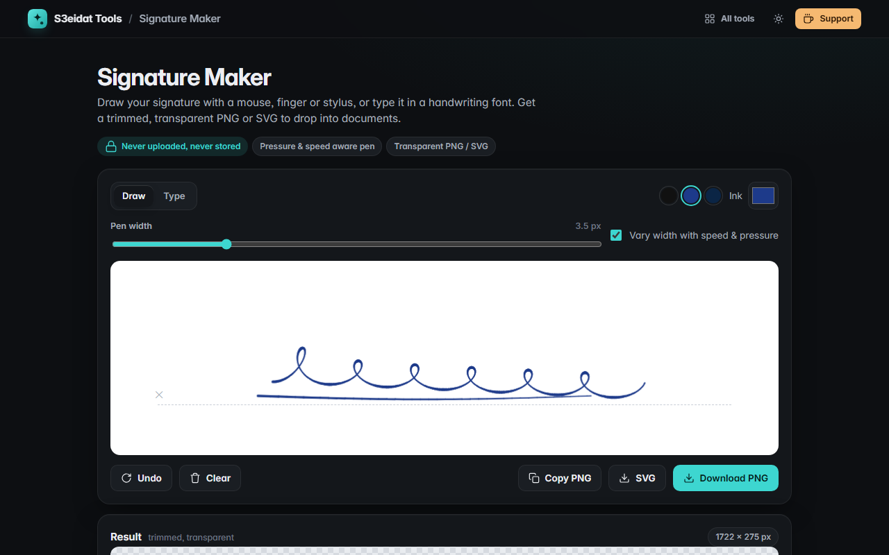

# Signature Maker

> Draw or type a signature and get a clean, trimmed, transparent PNG or SVG. Free, private, and it runs entirely in your browser.

### ▶ [Open Signature Maker](https://s3eidat.github.io/signature-maker/)



## Features

- **Draw** with a mouse, finger or stylus: smooth curves, line width that follows **pen pressure** (stylus) or **speed** (mouse/touch)
- Pen colour (black, blue, navy or any colour) and width; **undo** (Ctrl+Z) and clear
- **Type** your name in a handwriting font installed on your device (the list only shows fonts your device actually has)
- Output is **trimmed** to the signature with a small margin and has a **transparent background**
- Download a high-resolution **PNG**, a vector **SVG** (drawn signatures), or **copy** the PNG to the clipboard

## Privacy

Your signature is never uploaded and never saved: refresh the page and it's gone. Only pen settings (colour,
width, font) are remembered in localStorage. The page ships with a strict Content-Security-Policy
(`connect-src 'self'`), so the browser itself blocks any attempt to send data anywhere.

## Run it yourself

It's plain HTML, CSS and JavaScript with no build step:

```bash
git clone https://github.com/s3eidat/signature-maker
cd signature-maker
python -m http.server 8000
```

Then open http://localhost:8000.

## Support

If this saved you time, **[buy me a coffee ☕](https://s3eidat.github.io/coffee/)**. It keeps every tool free.

---

Part of **[S3eidat Tools](https://s3eidat.github.io/)**: 100+ free, private tools that run in your browser. MIT licensed.
